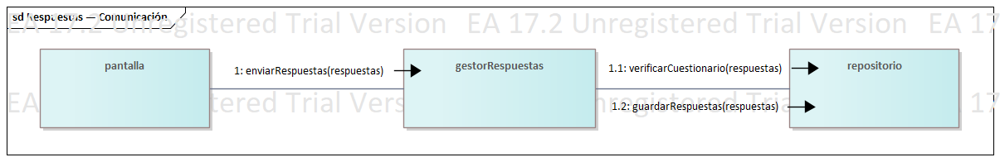
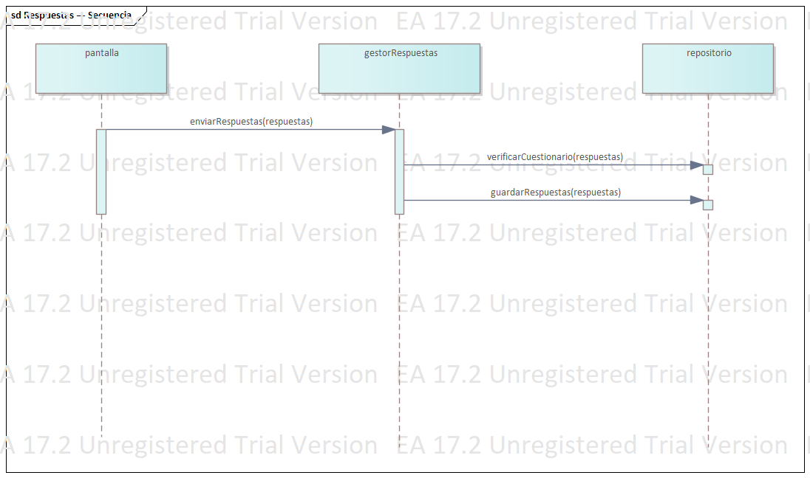
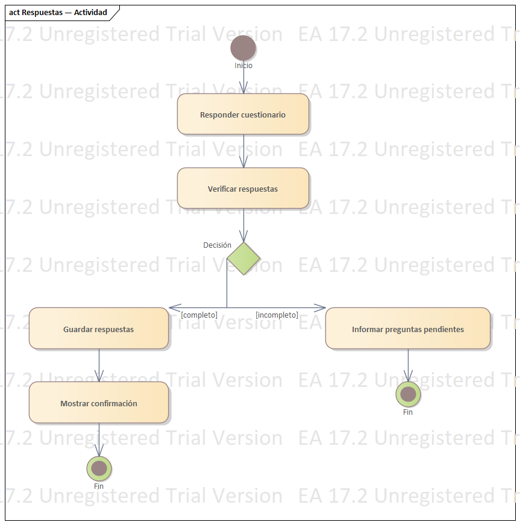

# VetQR · Diagramas UML (Semana 15)

Práctica guiada de diagramas UML · Unidad IV · Análisis y Diseño Orientado a Objetos
Universidad Americana (UAM) · Estudiante: Julio José Rodríguez de Jesús

Repositorio del proyecto de Enterprise Architect en formato **FEAP**, con los diagramas de **comunicación**, **secuencia** y **actividad** del sistema **VetQR**.

## Contenido

| Archivo | Descripción |
|---|---|
| `VetQR-Semana15.feap` | Proyecto de Enterprise Architect (formato FEAP). Paquete **Semana 15** con los tres diagramas. |
| `diagramas/Respuestas-Comunicacion.png` | Diagrama de comunicación |
| `diagramas/Respuestas-Secuencia.png` | Diagrama de secuencia |
| `diagramas/Respuestas-Actividad.png` | Diagrama de actividad |
| `Practica-Semana15-VetQR.pdf` | Caso, tabla de mensajes y diagramas |

## Caso

Un participante (dueño de mascota) termina el cuestionario de VetQR y lo envía. El sistema verifica que el cuestionario esté activo y que las preguntas obligatorias tengan respuesta. Si está **completo**, guarda las respuestas y muestra la confirmación. Si está **incompleto**, informa qué preguntas faltan y termina el intento sin guardar.

Comunicación y secuencia muestran el escenario exitoso. Actividad muestra las dos rutas.

## Mensajes del escenario exitoso

| Orden | Origen | Destino | Mensaje |
|---|---|---|---|
| 1 | pantalla | gestorRespuestas | `enviarRespuestas(respuestas)` |
| 1.1 | gestorRespuestas | repositorio | `verificarCuestionario(respuestas)` |
| 1.2 | gestorRespuestas | repositorio | `guardarRespuestas(respuestas)` |

## Diagramas

### Comunicación

### Secuencia

### Actividad

- **[completo]:** Responder cuestionario → Verificar respuestas → Guardar respuestas → Mostrar confirmación → Fin
- **[incompleto]:** Responder cuestionario → Verificar respuestas → Informar preguntas pendientes → Fin, sin guardar

## Cómo abrir el proyecto

Descarga `VetQR-Semana15.feap` y ábrelo con Enterprise Architect (**Open Project**). Los diagramas están en el paquete **Semana 15**.